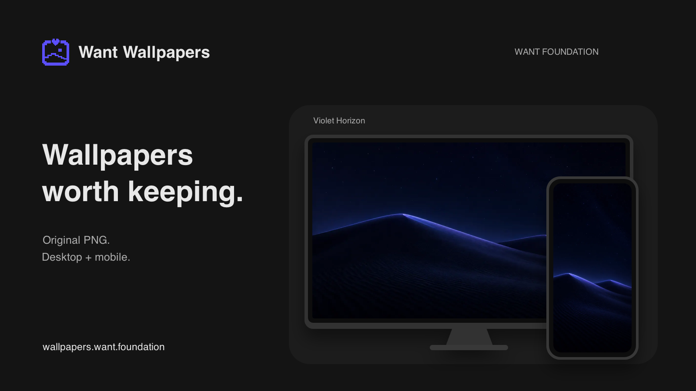

# Want Wallpapers

[English](README.md) · [Русский](README.ru.md)

[wallpapers.want.foundation](https://wallpapers.want.foundation/ru/) · [Telegram Channel](https://t.me/want_wallpapers)

Обои, которые хочется оставить.

[](https://wallpapers.want.foundation/ru/)

## О проекте

Want Wallpapers собирает авторские обои для экранов, которыми вы пользуетесь каждый день. Выберите настроение и скачайте горизонтальный или вертикальный PNG. У каждого дизайна есть композиция для компьютера и телефона, чтобы экраны сочетались и сохраняли удобное для своего формата расположение деталей.

На сайте есть тематические коллекции, поиск по сюжету и цвету, истории работ, оценки и комментарии. Доступны английский, русский, упрощённый китайский, бразильский португальский, японский и арабский языки. Для просмотра и скачивания аккаунт не нужен.

Проект поддерживает [Andrey Krasheninnikov](https://github.com/andrey-krasheninnikov). По вопросам проекта, лицензирования и сотрудничества пишите на [wallpapers@want.foundation](mailto:wallpapers@want.foundation).

## FAQ

### Обои бесплатные?

Да. Опубликованные обои бесплатны для личного использования на собственных экранах. Они доступны и при отказе от необязательной аналитики или рекламы.

### Какой файл скачивать?

Для горизонтального экрана выбирайте desktop, для вертикального mobile. Файлы скачиваются в PNG; размеры зависят от изображения. Обои можно обрезать под собственный экран.

### Можно использовать изображения в продукте или коммерческом проекте?

Сначала напишите на [wallpapers@want.foundation](mailto:wallpapers@want.foundation). Лицензия обоев разрешает личное некоммерческое использование. Продажа, распространение наборов и коммерческое использование требуют отдельного разрешения.

### Нужна регистрация?

Для просмотра и скачивания аккаунт не нужен. Оценки и комментарии используют анонимный сеанс браузера. У администрации отдельный защищённый вход.

### Что будет при отказе от отслеживания?

Просмотр, поиск и скачивание останутся доступны. Аналитика и реклама имеют независимые настройки в разделе cookie внизу сайта. Защищённые действия, например отправка комментария, используют reCAPTCHA Enterprise независимо от необязательной аналитики. Подробнее в [политике согласия](docs/adr/0005-regional-availability-and-consent.md).

## Монетизация

В проект подключены Яндекс Auto Placement и баннеры Adsterra. Выбор провайдера зависит от страны и рекламных настроек посетителя; главные страницы и админка исключены. Просмотр рекламы не является условием скачивания обоев. [Документация рекламы](docs/advertising-providers.md) описывает интеграцию и необходимые production-проверки. Наличие интеграции не подтверждает показы, выплаты или доход.

Возможные будущие источники дохода: физические издания, лицензии и AR/VR-проекты из плана ниже. Это идеи, а не уже продающиеся продукты. Здесь не объявляются платный тариф, магазин или ссылка для донатов. Опубликованные обои остаются бесплатными для личного использования.

## Форк и локальный запуск

Frontend использует Astro, React и shadcn/ui. Rust API работает на Axum, Tokio и SQLx с PostgreSQL 18. Firebase нужен только для необязательной Analytics.

Создайте форк на GitHub, замените `YOUR-USERNAME` своим именем и начните рабочую ветку от upstream development:

```bash
git clone https://github.com/YOUR-USERNAME/want-wallpapers.git
cd want-wallpapers
git remote add upstream https://github.com/andrey-krasheninnikov/want-wallpapers.git
git fetch upstream development
git switch -c my-change upstream/development
make install
```

Нужны Bun 1.3.14, Rust 1.93.0, Python 3, FFmpeg и Docker. По [инструкции локальной настройки](docs/development.md#local-setup) подготовьте отдельный PostgreSQL, приватные файлы администратора и development-настройки. Production credentials не нужны. Руководство содержит все шаги; n8n для запуска сайта не требуется.

После настройки окружения соберите сайт и запустите backend:

```bash
make build
set -a
. ./.env
set +a
cargo run --locked -p want-wallpapers-server -- migrate
make dev-backend
```

Во втором терминале из того же репозитория:

```bash
make dev
```

Откройте <http://localhost:4321>. Frontend проксирует `/api` на Rust по адресу `127.0.0.1:8080`. Первая сборка загружает изображения каталога и требует доступа к публичному CDN. Подробные проверки, команды каталога, ссылки на деплой и сведения об устранении проблем сохранены в [руководстве разработки](docs/development.md).

## Участие в проекте

[Создайте issue](https://github.com/andrey-krasheninnikov/want-wallpapers/issues/new), чтобы сообщить об ошибке, предложить коллекцию или улучшение. Для ошибки укажите URL страницы, шаги воспроизведения и ожидаемое поведение. Не включайте credentials и личные данные в отчёты.

Можно помочь с переводами, доступностью, документацией и кодом. Крупные изменения сначала обсудите в issue. Держите изменения в рамках задачи и направляйте PR в `development`. Соблюдайте [визуальную систему](DESIGN.md) и выполняйте затронутые проверки из [руководства разработки](docs/development.md#checks). Шесть публичных языков и существующие ссылки скачивания должны оставаться рабочими.

Если предлагаете изображения или физическое издание, укажите свои права на материалы и обсудите условия публикации до отправки файлов. Лицензия кода не предоставляет коммерческих прав на существующую коллекцию обоев.

## Changelog и последнее обновление

Полная история, включая ещё не выпущенные изменения: [CHANGELOG.md](CHANGELOG.md).

Последний опубликованный релиз: [v1.9.3](https://github.com/andrey-krasheninnikov/want-wallpapers/releases/tag/v1.9.3), 20 октября 2026 года. Добавлены арабский язык и направление RTL, кнопка обратной связи занимает полную ширину, а боковая реклама лучше учитывает увеличенный текст. Обновление README не меняет версию приложения.

## План развития

Десять направлений для проверки спроса в физическом мире и AR/VR. Сроки и прогнозы дохода не заявлены. Печатным изданиям нужны файлы для печати и цветопробы; XR-проектам нужны отдельные сцены и проверки на устройствах. Скачиваемый PNG сам по себе этого не обеспечивает.

1. Лимитированные арт-принты и постеры для коллекционеров. Доход от номерных тиражей; первая проверка спроса: небольшой предзаказ после утверждения одной цветопробы.
2. Фотообои под размер стены для домов и студий с AR-примеркой. Доход от изготовления на заказ; первый тест: одна комната с печатным партнёром.
3. Коврики для стола и интерьерный текстиль для согласованного оформления рабочего места. Доход от продажи изделий; начать с образца материала и сбора заявок о заинтересованности.
4. Кураторские коллекции для владельцев цифровых рамок. Доход от лицензий на показ или подписки; сначала проверить одну совместимую модель.
5. Проекционные инсталляции для кафе, отелей и событий. Доход от оформления пространства или лицензии на показ; первый шаг: короткий пилот с одной площадкой.
6. Печатные работы с AR-анимацией. Доход от физического издания с включённым цифровым опытом; сначала показать одну работу через камеру телефона.
7. AR-порталы из комнаты в мир коллекции. Доход от продажи сцен или доступа к тематическому пространству; первый шаг: один прототип портала и отзывы зрителей.
8. VR-пространства для отдыха и концентрации. Доход от отдельных окружений или тематических наборов; сначала испытать одну сцену на одной платформе шлемов.
9. Билетные виртуальные выставки. Доход от входных билетов или спонсорства; до постоянной галереи проверить небольшую экспозицию и спрос.
10. Заказные AR/VR-сцены для брендов и пространств. Доход от разработки и оговорённых прав использования; небольшая демонстрация поможет найти первый платный пилот.

## Лицензия

Код и документация доступны по [лицензии MIT](LICENSE).

Для обоев действуют отдельные [условия личного использования](https://wallpapers.want.foundation/ru/license/). Разрешены скачивание, показ на собственных устройствах и обрезка для себя. Продажа, распространение наборов и коммерческое использование требуют разрешения. Баннер содержит работу из каталога и не расширяет права на изображения. По вопросам лицензирования пишите на [wallpapers@want.foundation](mailto:wallpapers@want.foundation).
