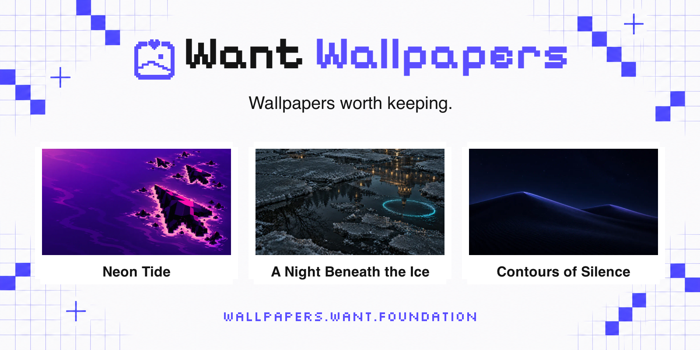

<p align="center">
  <a href="https://wallpapers.want.foundation/ru/">
    <picture>
      <source media="(prefers-color-scheme: dark)" srcset="docs/assets/cover-dark.png">
      <source media="(prefers-color-scheme: light)" srcset="docs/assets/cover-light.png">
      
    </picture>
  </a>
</p>

<p align="center">
  <a href="README.md" lang="en">English</a> · <a href="README.ru.md" lang="ru">Русский</a><br>
  <a href="https://wallpapers.want.foundation/ru/">wallpapers.want.foundation</a> · <a href="https://t.me/want_wallpapers">Telegram Channel</a><br>
  <a href="https://wallpapers.want.foundation/wallpapers/neon-tide-7/">Lunar molt</a> · <a href="https://wallpapers.want.foundation/wallpapers/woven-spectrum-4/">Colour Rays</a> · <a href="https://wallpapers.want.foundation/wallpapers/contours-of-silence-11/">Tree of the Night</a>
</p>

<p align="center">
  <a href="https://github.com/andrey-krasheninnikov/want-wallpapers/releases/latest"></a>
  <a href="LICENSE"></a>
  <a href="https://github.com/andrey-krasheninnikov/want-wallpapers/stargazers"></a>
</p>

## 🧭 Содержание

- [О проекте](#-о-проекте)
- [FAQ](#-faq)
- [Монетизация](#-монетизация)
- [Форк и локальный запуск](#-форк-и-локальный-запуск)
- [Участие в проекте](#-участие-в-проекте)
- [Changelog и последнее обновление](#-changelog-и-последнее-обновление)
- [План развития](#-план-развития)
- [Лицензия](#-лицензия)

## 🌄 О проекте

Авторские PNG-обои с отдельными композициями для компьютера и телефона, чтобы оба экрана сочетались.

- Тематические коллекции, поиск по сюжету и цвету, истории, оценки и комментарии.
- Шесть языков: английский, русский, упрощённый китайский, бразильский португальский, японский и арабский.
- Просмотр и скачивание без аккаунта.

Автор: [Andrey Krasheninnikov](https://github.com/andrey-krasheninnikov). Вопросы и сотрудничество: [wallpapers@want.foundation](mailto:wallpapers@want.foundation).

## 💬 FAQ

### Обои бесплатные?

Да, для личного использования на своих экранах, в том числе при отказе от необязательной аналитики или рекламы.

### Какой файл скачивать?

Desktop для горизонтального экрана, mobile для вертикального. Оба формата в PNG; размеры различаются, обрезать для себя можно.

### Можно использовать коммерчески?

Продажа, распространение наборов и коммерческое использование требуют разрешения. Напишите на [wallpapers@want.foundation](mailto:wallpapers@want.foundation).

### Нужна регистрация?

Просмотр и скачивание доступны без аккаунта. Оценки и комментарии используют анонимный сеанс; у администрации отдельный защищённый вход.

### Что будет при отказе от отслеживания?

Просмотр, поиск и скачивание останутся доступны; у аналитики и рекламы отдельные cookie-настройки внизу сайта. Защищённые действия, например комментарии, используют reCAPTCHA Enterprise независимо от необязательной аналитики: [политика согласия](docs/adr/0005-regional-availability-and-consent.md).

## 💸 Монетизация

HilltopAds показывает баннеры и всплывающие окна с учётом настроек рекламы; главные страницы и админка исключены. Реклама не ограничивает скачивание. [Документация провайдеров и production-проверки](docs/advertising-providers.md); сама интеграция не подтверждает доход.

Платного тарифа, магазина и ссылки на донаты нет. Идеи ниже описывают возможные источники дохода; опубликованные обои остаются бесплатными для личного использования.

## 🔧 Форк и локальный запуск

Frontend: Astro, React и shadcn/ui. Backend: Rust (Axum, Tokio, SQLx) и PostgreSQL 18. Firebase нужен только для необязательной Analytics.

Создайте форк на GitHub, замените `YOUR-USERNAME` своим именем и выполните:

```bash
git clone https://github.com/YOUR-USERNAME/want-wallpapers.git
cd want-wallpapers
git remote add upstream https://github.com/andrey-krasheninnikov/want-wallpapers.git
git fetch upstream development
git switch -c my-change upstream/development
make install
```

Нужны Bun 1.3.14, Rust 1.93.0, Python 3, FFmpeg и Docker. [Локальная настройка](docs/development.md#local-setup): отдельная БД, приватные файлы, окружение и запуск без production credentials. Первая сборка требует публичного CDN; откройте <http://localhost:4321>.

## 🤝 Участие в проекте

[Создайте issue](https://github.com/andrey-krasheninnikov/want-wallpapers/issues/new) с URL страницы, шагами и ожидаемым поведением. Не публикуйте credentials и личные данные.

Можно помочь с переводами, доступностью, документацией и кодом. Крупные изменения обсудите заранее, направляйте PR в `development`, соблюдайте [DESIGN.md](DESIGN.md) и выполняйте [затронутые проверки](docs/development.md#checks). Сохраните шесть языков и ссылки скачивания. Для изображений сначала подтвердите права и согласуйте условия публикации.

## 📝 Changelog и последнее обновление

[Полная история](CHANGELOG.md) · [Последний релиз: v1.9.3](https://github.com/andrey-krasheninnikov/want-wallpapers/releases/tag/v1.9.3), 20 октября 2026 года: арабский язык и RTL, кнопка обратной связи на всю ширину и отступы боковой рекламы.

## 💡 План развития

Десять идей заработка для проверки спроса, без обещаний по срокам и доходу. Печати нужны цветопробы, XR-проектам отдельные сцены и тесты на устройствах.

1. Номерные арт-принты и постеры для коллекционеров, начиная с небольшого предзаказа.
2. Фотообои под размер стены с AR-примеркой и оплатой по размеру комнаты.
3. Коврики для стола и интерьерный текстиль для оформления рабочего места.
4. Кураторские коллекции для цифровых рамок по лицензии на показ или подписке.
5. Проекционные инсталляции для кафе, отелей и событий на заказ или по лицензии.
6. Печатные работы с включённым слоем AR-анимации.
7. AR-порталы в мир коллекции с продажей сцен или доступа.
8. VR-пространства для отдыха и концентрации по одному или наборами.
9. Виртуальные выставки с доходом от билетов или спонсорства.
10. Заказные AR/VR-сцены для брендов и пространств с оговорёнными правами использования.

## 📄 Лицензия

Код и документация: [MIT](LICENSE). Обои: отдельные [условия личного некоммерческого использования](https://wallpapers.want.foundation/ru/license/), включая показ и обрезку для собственных устройств.

Продажа, распространение наборов и коммерческое использование требуют разрешения. Обложка не расширяет права на изображения. Лицензирование: [wallpapers@want.foundation](mailto:wallpapers@want.foundation).
